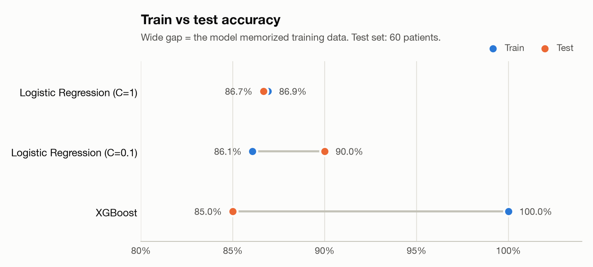
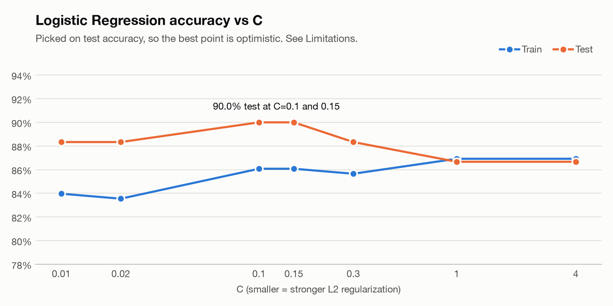
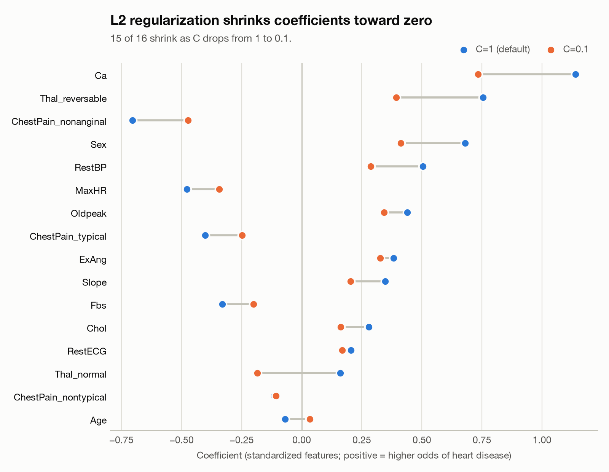

# heart-disease-classification-model-comparison

Predicting heart disease from patient data with Logistic Regression and XGBoost, then checking what L2 regularization does to accuracy and coefficients. 297 patients, 16 features, one 80/20 split.

<picture>
  <source media="(prefers-color-scheme: dark)" srcset="figures/heart_accuracy_gap-dark.png">
  
</picture>

Notebook: [heart_classification.ipynb](heart_classification.ipynb)

## Data

The Heart dataset from *Python for Data Science*, a version of the UCI Cleveland heart disease data. It has 303 patients, 13 features and a Yes/No target, `AHD`.

- 6 rows have missing values (4 in `Ca`, 2 in `Thal`) and get dropped, leaving 297.
- Classes are close to balanced: 160 No, 137 Yes.
- The categorical columns `ChestPain` and `Thal` are one-hot encoded with `drop_first=True`, giving 16 numeric features.

## Pipeline

1. Split 80/20 with `random_state=42`: 237 train, 60 test.
2. Fit `StandardScaler` on the training set only, then apply it to both sets.
3. Train three models:
   - `LogisticRegression` with the default `C=1`
   - `LogisticRegression` with `C=0.1` (stronger L2 penalty)
   - `XGBClassifier` with default settings
4. Score accuracy on both train and test.

## Results

| Model | Train acc | Test acc | Test correct |
|---|---|---|---|
| Majority class (always "No") | n/a | 60.0% | 36 / 60 |
| Logistic Regression, C=1 | 86.9% | 86.7% | 52 / 60 |
| Logistic Regression, C=0.1 | 86.1% | **90.0%** | 54 / 60 |
| XGBoost | 100.0% | 85.0% | 51 / 60 |

XGBoost memorized the training set and did the worst on test. Logistic Regression with C=0.1 scored lower on train than C=1 but higher on test. That's regularization working as intended: it gives up some fit on the training data to generalize better.

The notebook defines a list of C values but only trains C=0.1. [heart_figures.py](heart_figures.py) runs the full sweep:

<picture>
  <source media="(prefers-color-scheme: dark)" srcset="figures/heart_c_sweep-dark.png">
  
</picture>

Test accuracy peaks at 90.0% for C=0.1 and C=0.15. Above C=1 the penalty is too weak to matter, and C=4 gives the same result as C=1.

The coefficients show what the penalty is doing:

<picture>
  <source media="(prefers-color-scheme: dark)" srcset="figures/heart_coefficients-dark.png">
  
</picture>

Going from C=1 to C=0.1, 15 of 16 coefficients move toward zero. `Ca` (number of major vessels colored by fluoroscopy) stays the strongest predictor either way.

## Takeaways

In this project, I learned how to build and compare classification models.

1. I cleaned the dataset, separated features (X) from the target (y), and used one-hot encoding to convert categorical features into numbers.
2. I split the data into training (80%) and testing (20%). I learned that we should fit the scaler only on training data and apply the same transformation to test data to avoid data leakage.
3. I trained Logistic Regression and XGBoost models. Logistic Regression learns coefficients by minimizing log loss, while XGBoost combines multiple decision trees.
4. I learned the difference between loss and accuracy. Loss measures prediction errors and is minimized during training, while accuracy measures the percentage of correct predictions.
5. I experimented with explicit L2 regularization. A smaller C means stronger regularization, which pushes coefficients closer to zero and can help prevent overfitting.
6. XGBoost achieved 100% training accuracy but only 85.00% test accuracy, suggesting overfitting. Logistic Regression with C=0.1 achieved the highest test accuracy of 90.00%.
7. My biggest takeaway is that higher training accuracy doesn't necessarily mean a better model. What matters is how well the model generalizes to unseen data. I also learned that a small train-test gap alone doesn't guarantee a good model.

Next time, I want to use cross-validation to select models without repeatedly relying on test accuracy.

## Limitations

- **C was picked using the test set.** Choosing the best C by test accuracy turns the test set into a validation set, so 90.0% is an optimistic estimate. Picking C with cross-validation on the training set (`LogisticRegressionCV`) and touching the test set once would fix this.
- **The test set is small.** With 60 patients, each one is worth 1.7 points of accuracy. The gap between C=0.1 (90.0%) and C=1 (86.7%) is 2 patients, and between C=0.1 and XGBoost it's 3.
- **There's only one split.** Everything uses `random_state=42`. A different split could reorder the models.
- **XGBoost is untuned.** It runs with default settings. Limiting `max_depth` or `n_estimators` would likely close some of the train/test gap.
- **The notebook has a no-op imputer.** It runs `SimpleImputer` after `dropna` has already removed every missing value, so the step does nothing.
- **The notebook uses a deprecated argument.** In scikit-learn 1.8+, `penalty='l2'` raises a `FutureWarning`. L2 is the default, so the argument can be dropped. `heart_figures.py` already leaves it out.

## Running it

Tested on Python 3.14.

```bash
python3 -m venv .venv
source .venv/bin/activate
pip install -r requirements.txt
brew install libomp   # macOS only: XGBoost needs the OpenMP runtime
```

Open `heart_classification.ipynb` in VS Code or Jupyter and select the `.venv` kernel.

To regenerate the figures and print every number in this README:

```bash
python heart_figures.py
```

```
rows: 303 raw, 297 after dropna, 16 features after get_dummies
split: 237 train / 60 test
AHD all: {'No': 160, 'Yes': 137}  test: {'No': 36, 'Yes': 24}
Logistic Regression (C=1): train 0.8692  test 0.8667  (52/60 correct)
Logistic Regression (C=0.1): train 0.8608  test 0.9000  (54/60 correct)
XGBoost: train 1.0000  test 0.8500  (51/60 correct)
...
```

## Layout

```
heart_classification.ipynb   the experiment, cell by cell
heart_figures.py             reruns the experiment and writes figures/
figures/                     README charts, light and dark versions
requirements.txt
```

## Stack

Python, pandas, scikit-learn, XGBoost, matplotlib, Jupyter.
